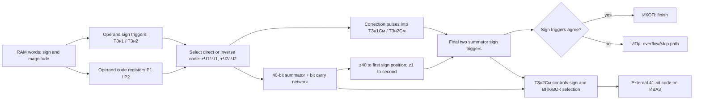

# ISA-06 D8 — reconstruction of the adder sign path (research record)

**Repository base:** `41a452b` (ISA-06 D7, 2026-10-17).  **Status:** DOCUMENTARY / MODEL-ONLY.  **Changes:** this note, its evidence ledger, its source manifest, and a standalone model-comparison script. **No edits** to `src/`, `inc/`, `mem/`, existing tests, historical programs, or root README.

**Research question:** What exact external 41-bit code does Kyiv produce for arithmetic `01` when the mathematical sum is zero, especially `(-0)+(+0)` used by the fourth historical RAM test? Which **internal** sign and carry states must be established before an exact-code result can be used as a historical `STRICT` oracle?

## 0. Conventions, reproducibility, and epistemic labels

- Every instruction, memory address and 41-bit code shown with a leading `0` or an explicit `₈` is **octal**. Bit counts and timing quantities are decimal. `+0` is `00 0000 0000 0000` (octal); `-0` is `20 0000 0000 0000` (octal). The external word has one sign bit and 40 magnitude bits; internal adder encoding is **not** interchangeable with external memory encoding.
- **[DOC]**: explicitly stated in the cited printed page or directly visible in a numbered circuit/diagram. **[DERIVED]**: a logical consequence, with premises listed. **[HYP]**: one of several consistent models, not historical truth. **[OBS]**: outcome from the current emulator, not historical truth. **[OPEN]**: unresolved; do **not** convert to `STRICT`.
- The **printed page number** is authoritative. The 1964 scan is photographed as two printed pages per image. For rediscovery: `kiev0048.png` contains pp. 94–95; `0049` 96–97; `0050` 98–99; `0051` 100–101; `0052` 102–103; `0069` 136–137; `0070` 138–139; `0073` 144–145; `0074` 146–147. These filenames are source locators, *not repository artifacts*; do not commit the original scan images. The 1962 reference is the separate searchable PDF.
- Source-specific, numbered evidence and negative claims live in `docs/ISA_06_D8_EVIDENCE_LEDGER.tsv`, and immutable source-file/image digests in `docs/ISA_06_D8_SOURCE_MANIFEST.tsv`. Record the exact diagram labels on a source image before treating a line as an electrical connection. Neither text nor this research notebook substitutes for a validated full gate-level trace.
- Run the standalone comparator with `python tools/isa06_d8_sign_models.py --check`; it requires only the Python standard library and **does not call the CPU**. Its output is model predictions, not machine tests.

## 1. Historically established statements, with exact scope

| Ref | Printed location | Source statement / observable circuitry | What it **does not** prove |
|---|---|---|---|
| GY62-A | Glushkov–Yushchenko (1962), p. 11 | `01` is algebraic addition; arithmetic instructions use effective addresses. | Sign selection when the algebraic result is **exactly zero**. |
| GY62-B | 1962, p. 13 | Subtracting two equal numbers produces **negative zero**; `16` requires equality of sign and magnitude; `31` branches according to sign. | The same negative-zero rule for addition `01`. |
| GY62-C | 1962, pp. 170–171 | Historical fourth RAM test includes `0123` and `0141`: `01 0021 0000 0020`, used for copying its moving pattern, then exact-code comparison. | Authentic initialization of all memory cells or a full-program PASS. |
| DPS64-A | Dashevsky–Pogrebinsky–Shkabara (1964), p. 94 | External direct-code representation supports separate `+0` and `−0`, and orders `+0 > −0` in comparison. | Result sign of an addition of zeros. |
| DPS64-B | 1964, pp. 96–98 | Internal adder uses per-bit complements for negatives, not simply an external sign-magnitude integer; control includes carries and overflow. | A unique zero-sign outcome without the **two sign triggers** and result conversion. |
| DPS64-C | 1964, p. 94 | A one-cycle operation is organized as several stages: receive operands, form each sign, transfer operands, form result sign, and issue result. | A single atomic “integer sum” formula for the hardware. |
| DPS64-D | 1964, pp. 100–102, Fig. 62, Table 4 | `01`: `ПОп` and reset; first sign / first number, second sign / second number; `И1`, `И2`, `И3`, `И4`, and separated carry and result-output signals. | A per-input truth table of `ТЗн1См`, `ТЗн2См` for zero. |
| DPS64-E | 1964, p. 101 | First operand's code depends on `Зн1`; second's depends on `Зн2`. Negative code uses the inverse-code transfer path. `И2` starts second-number addition; carries follow. | That the final *external* sign equals either input sign. |
| DPS64-F | 1964, p. 137, Fig. 67; p. 138 | Each magnitude bit has `P1`, `P2`, `ТСм` and carry `z`; code output has direct/inverted paths (`ВПК`/`ВОК` in the circuit). | Exact adder sign logic; Fig. 67 is primarily a **bit-slice**, not the whole sign block. |
| DPS64-G | 1964, pp. 144–145, Figs. 71–72 | Operand sign triggers `ТЗн1`/`ТЗн2`, **distinct** summator sign triggers `ТЗн1См`/`ТЗн2См`; negative-code correction pulses drive the latter; `z40` enters the first sign position, and its carry `z1` propagates toward the second. | Values of all gates/carry pulses for each exact-zero pair. |
| DPS64-H | 1964, pp. 145–146, Fig. 73 | Matching `ТЗн1См` and `ТЗн2См` enables normal completion; differing states trigger overflow/skip control; result code selection and sign output occur on `ИВА3`. External **sign** is issued from `ТЗн2См`, through the documented output path. | Whether `ТЗн2См` is 0 or 1 after `(-0)+(+0)` without evaluating earlier signals. |
| DPS64-I | 1964, p. 146 | At output, `ВПК` / `ВОК` are selected by `ТЗн2См` and the sign digit is delivered separately from that trigger. | That an all-zero *magnitude* necessarily has positive sign. |

### Important correction to an attractive but insufficient argument

**[DERIVED]** The fact that negative zero may enter the adder as an all-ones-like *complementary magnitude code* does **not**, alone, prove `01(-0,+0) -> -0`. The result is produced after sign-correction pulses, potential carries `z40` and `z1`, validation of the two sign triggers, and output direct/complement selection. Without establishing the actual `ТЗн2См` on the output strobe, “a complemented -0 must stay -0” is **not a proof**. Likewise, the source's explicit `02(equal,equal) -> -0` cannot be extrapolated to every zero-result `01`.

## 2. Hardware sign path: functional dependencies, NOT a timing-complete netlist

The following is a dependency trace assembled from **Fig. 62 / Table 4 and Figs. 67, 71–73**. It is deliberately not called a simulation of the actual electrical circuit:

The `ТЗн1См`/`ТЗн2См` *agreement* is an overflow criterion; **do not equate agreement with a positive sign**. The source separately states which trigger issues the sign. This distinction must be preserved in future software design (e.g., represent `(magnitude_code, sign_state, overflow_state)` while diagnosing an operation, not only a host signed integer).

### 2.1 Sequence of documented logical micro-events

| Step | Operation/event | Established signals and consequence | Missing input needed for an executable model |
|---|---|---|---|
| S0 | End of previous operation / prepare `01` | `ПОп` resets arithmetic state; Fig. 67 describes reset of ordinary summator/register triggers, Fig. 71 sign-block reset is diagrammed. | Precise initial values of **both** `ТЗн*См` for this opcode/edge; any outstanding carry. |
| S1 | Receive operand 1, sign | On `ИВА1`/`ПЧ1`, first operand arrives and `Зн1` is latched (p. 144). | Confirm propagation of `-0` sign from ROM/RAM into sign trigger, independent of magnitude-zero detection. |
| S2 | `И1` first-number transfer | `+Ч1` or `−Ч1` chosen by sign; inverse code for negative; correction pulse path (pp. 101, 145). | Exact values of 40-bit accumulator and both sign triggers immediately **after** `И1` in `−0` case. |
| S3 | Receive operand 2, sign | On `ПЧ2`, load `P2`, latch `Зн2` (p. 144). | Establish whether first-number effects remain stable. |
| S4 | `И2` second-number transfer | `+Ч2` or `−Ч2` chosen by sign; bitwise modulo-2 addition and negative correction path. | Whether negative-zero transfer emits the correction pulse once; exact pre-carry sign values. |
| S5 | Delayed carries | Carries start after the sum interval: `z40` feeds first sign; carry from first sign reaches second (p. 145); Fig. 62 shows delays. | **Concrete** `z40`, sign-position carry `z1`, any end-around effects for each case. |
| S6 | `И4` completion/overflow selection | Agreement of sign triggers permits `ИКОП`; disagreement selects `ИПр` (pp. 101,145). | Both sign bits after carries; precise stop/skip settings relevant to each trace. |
| S7 | `ИВА3` output | `ТЗн2См` selects `ВПК`/`ВОК` and provides external sign `КШЗ41` (p. 146). | Exact output magnitude bits after direct/inverted conversion; external zero sign. |

**Do not treat `S0..S7` as eight oscillator periods.** They are causal events, some overlapping or separated by specific delays. Published time labels (for instance `И1`/`И2` delays and `И4`) are not enough to recover every individual gate transition. For an actual logic simulation, use Fig. 71/72/73 gate connections, actual pulse polarities, input pulse shapes and assumptions about stabilization.

### 2.2 Pending two-sign-trigger worksheet (unknowns are intentional)

This sheet records the **required** micro-observations, rather than fabricated bit values. `?` means not established by cited source text alone. Fill from a traced Fig. 71 netlist, NOT from the emulator's resulting word.

| External inputs | `Зн1`/`Зн2` [DOC] | 1st transfer path [DOC] | 2nd transfer path [DOC] | `z40` | `z1` | `ТЗн1См` after carry | `ТЗн2См` after carry | External sign [OPEN] |
|---|---|---|---|---|---|---|---|---|
| +0, +0 | 0 / 0 | +Ч1 | +Ч2 | ? | ? | ? | ? | ? |
| +0, −0 | 0 / 1 | +Ч1 | −Ч2 | ? | ? | ? | ? | ? |
| −0, +0 | 1 / 0 | −Ч1 | +Ч2 | ? | ? | ? | ? | ? |
| −0, −0 | 1 / 1 | −Ч1 | −Ч2 | ? | ? | ? | ? | ? |
| +5, −5 | 0 / 1 | +Ч1 | −Ч2 | ? | ? | ? | ? | ? |
| −5, +5 | 1 / 0 | −Ч1 | +Ч2 | ? | ? | ? | ? | ? |

The numeric `5` here is a **synthetic** small positive magnitude (`000...005`), not a historical program datum. Use the same fixed magnitude for opposite-signed cancellation and distinguish input order.

## 3. Competing hypotheses: deliberately NOT the historical ISA

The standalone comparator implements these complete **toy models**. The model named `M1` is a *41-bit one's-complement arithmetic analogy*, not a reconstructed Kyiv circuit; the actual adder has separate sign-trigger logic and direct/complement output gating. `M2a/M2b` retain operand-1/operand-2 sign when the sum equals zero; they are diagnostic examples of order dependence, not supported hardware rules.

| Inputs to `01` | M0: current sign-of-host-sum policy | M1: one's-complement toy | M2a: first operand sign | M2b: second operand sign | Historical verdict |
|---|---|---|---|---|---|
| +0 + +0 | +0 | +0 | +0 | +0 | **OPEN** |
| +0 + −0 | +0 | −0 | +0 | −0 | **OPEN** |
| −0 + +0 | +0 | −0 | −0 | +0 | **OPEN** |
| −0 + −0 | +0 | −0 | −0 | −0 | **OPEN** |
| +5 + −5 | +0 | −0 | +0 | −0 | **OPEN** |
| −5 + +5 | +0 | −0 | −0 | +0 | **OPEN** |

For M1 the toy converts the **external** sign/magnitude representation into 41-bit one's-complement values, adds with end-around carry, then converts back. Agreement of M1 predictions with the program's intended RAM-test behavior would be *corroboration*, NOT validation of Fig. 71. The script produces raw octal words and the hypothesis table so future changes to model definitions are explicit and diffable.

## 4. Real-emulator evidence from ISA-06 D1–D7 (historical truth is separate)

- **[OBS]** D6 `01` returns `+0` for all four sign-zero pairs and both equal-magnitude cancellations. The arithmetic C++ path computes a signed integer and derives sign from `res < 0`; exactly zero cannot preserve operand sign (`src/main.cpp`, `Kyiv_t::opcode_arythm`).
- **[DOC/STRICT]** D6/D7 `02` applied to equal numbers returns `−0`, matching GY62 p. 13. This is a **subtraction-only** oracle.
- **[DOC/STRICT]** D7 `16` distinguishes `+0` from `−0`, and `31` branches on the stored sign; these are consequences after **any** arithmetic outcome, not proof of how `01` forms it.
- **[OBS]** At historical PCs `0123₈` and `0141₈`, opcode `01` with **injected** `RAM[0021] = −0` and hardwired cell `0000 = +0` yields `+0` today. The subsequent D7 `16`/`31` continuations are **synthetic instruments**, not transcribed historical next instructions.
- **[OBS]** D5's negative-zero read-prefix consequently reaches historical STOP after failing the exact comparison. The source's original RAM-test **intent** makes this a meaningful anomaly to research, but does not make the desired historical adder result automatically proven.
- `ROM.txt` values `3012 = +1`, `3026 = −0`, `3042 = top magnitude bit` are human transcriptions, not independently authenticated hardware ROM; D3 showed `Kyiv_t`'s constructor uses a CWD-sensitive `../mem/ROM.txt` and silently leaves RAM/ROM zeroed when opened from repository root. Keep ROM-loader remediation separate.

## 5. How to complete the hardware reconstruction later (reproducible protocol)

**Gate 0 — source freeze.** Pin both original PDFs (not OCR outputs), printed page references, Git base SHA, and SHA-256 of scans; **already recorded** in `ISA_06_D8_SOURCE_MANIFEST.tsv`. The source images must remain accessible in the Project or be re-supplied if the repository is cloned without the Project. Document new crops if made. Do not overwrite the source evidence to make a model fit.

**Gate 1 — netlist transcription.** For Figs. 67 and 71–73 enumerate every gate/trigger, input and active polarity. Distinguish combinational gates from count/set/reset inputs; name both edges. Trace sign correction inputs `−Ч1`, `−Ч2`; `z40`, `z1`; initialization `У0АУ`; control `И1`..`И4`; output `ИВА3` and `ВПК`/`ВОК`. Record unreadable crossings as `UNKNOWN`, not inferred connections.

**Gate 2 — symbolic transitions.** Implement a pure state transition system with **separate** registers for `P1`,`P2`, 40-bit summator, carry network, `ТЗн1См`,`ТЗн2См`, `ИКОП`, `ИПр`, selected result coding. Keep each transition source-linked in comments (page/figure/gate id). Do not start by hardcoding expected zero signs.

**Gate 3 — six traces.** For each of the six rows in §2.2 print the complete before/after state at `И1`, `И2`, carry stabilization, `И4`, `ИВА3`. Include both orders of opposite-signed operands, negative zero, intermediate carries, output sign and magnitude. Add one **nonzero** control in which sum is representable and one overflow control to calibrate sign-trigger/carry behavior.

**Gate 4 — independent checks.** Check the derived trace against (a) Table 4 signal permissions, (b) Fig. 71/72/73 connections, (c) external sign/magnitude representation and `+0 > -0`, (d) GY62's explicit equal-subtraction `−0` rule, and (e) original RAM test **without assuming a particular ROM transcription**. Prefer hardware test logs or additional documentary evidence independent of these two books if available.

**Gate 5 — result classification.** Each case must have a written proof chain from numbered gates and pulses to `ТЗн2См` at `ИВА3`. If all details are resolved and cross-checked, promote **only those cases** to `STRICT`. Cases with disputed gate polarities/timing stay `HYP/OBS`, even if a proposed rule matches historical program intent.

**Gate 6 — conditional CPU patch, separate change.** Only once Gate 5 succeeds: isolate opcode `01` sign logic, preserve 41-bit result coding and overflow/stop behavior, add **new** independent `STRICT` oracles, and rerun D1–D7, D5 positive-loop policies, and D5 signed-zero read-prefix. Report exact before/after paths and all changed OBS; do **not** silently rewrite historical comparisons or preexisting baselines.

### Acceptance record (fill when the gate-level work is done)

| Field | Required evidence | Current status |
|---|---|---|
| Source images pinned (hashes) | Original PDF/PNG + SHA-256 + page table | **DONE** in source manifest; scans remain in Project context, not Git |
| Fig. 71 netlist, all sign gates | Independent second reading of gate polarity and connection | OPEN |
| Fig. 72 code transfer control | `+Ч1/-Ч1`, `+Ч2/-Ч2`, correction pulse derivation | OPEN |
| Fig. 67 carries to sign section | `z40` and `z1` waveforms for all cases | OPEN |
| Fig. 73 completion/output conditions | `ИКОП`/`ИПр`, `ВПК`/`ВОК`, `ИВА3` | PARTIAL DOC |
| Six sign-result rows proven | Bit-exact `ТЗн2См` and `КШЗ41` for each | OPEN |
| Contradictory sources reconciled | GY62 vs DPS64 vs original program, ambiguities explicit | OPEN |
| CPU defect established? | At least one historical `STRICT` contradicting current output | **NO** |

## 6. Conclusion at D8 freeze

**[DOC]** The sign of opcode `01` is a hardware state-machine result: the output sign comes from `ТЗн2См` after correction and carries, not from the sign of the host language's integer sum. **[OBS]** The emulator currently maps every exact-zero `01` sum to `+0`. **[HYP]** A negative-zero-preserving model could explain the historical moving-zero diagnostic. **[OPEN]** The cited diagrams have not yet been reduced to an unambiguous complete sign-trigger transition table for all zero pairs. Therefore **no CPU patch** and **no promotion of `01` zero-sign outcomes to `STRICT`** at D8.

**Next task:** D8-H1, explicitly transcribe the gates and polarities of Fig. 71 with a line-by-line source-mapping table, then the Fig. 72 transfer control and Fig. 67 sign-facing carry circuit. This step is a **source reconstruction**, not an ISA guess. Archive the filled §2.2 worksheet and reproduce the `--check` comparator output. Keep the unresolved ROM path as a separate tracked issue.
