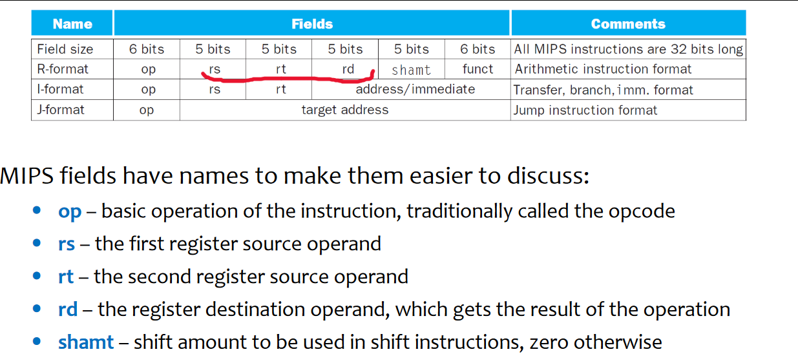
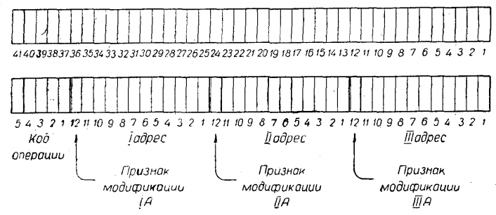

# Чи є «Київ» RISC-ISA?

> Ремарка: це дуже сирий текст, зокрема, потрібно провести аналогічну оцінку для ARM, MIPS, RISC-V, x86, PDP-11, PDP-8, 6502, z-архітектури IBM тощо.

## Аналіз

Коли почав знайомитися із системою команд (ISA) «Києва», відчув, що вона мені (О.Ф.) щось дуже нагадує(1). А саме – RISC, ідею із значно пізнішого часу.

Щоб порівнювати безпосередньо ідеї із настільки різних епох(3), давайте умовно розглядати адресний простір "Києва" як 2048 регістрів, з яких 1024 доступні для читання й запису, а ще 1024 -- лише для читання, і не має окремої RAM(9). До певної межі це справа термінології. Такий підхід існував і в значно ближчих до нас часах(4). На користь такої інтерпретації можна навести два (аж ніяк не абсолютні) аргументи: розмір  адресного простору цієї машини фіксований, і код команд містить всі три адреси безпосередньо, закодовані, схоже на кодування регістрів у класичних RISC (8).

Критерії RISC візьмемо із [4], див. також статті із Wiki [5, 6].

### 1. Команди ортогональні.

«Київ» не дуже відповідає ідеальному RISC: скажімо, «сложение» і «сложение команд» не ортогональні. Однак у реальних RISC схожі команди, які видаються дуже корисними, наприклад, збільшують густину коду (5), теж є.

Нехай, консервативно, 3 бали із 5.

### 2. Кодування команд однорідне – є мало видів кодування, опкоди різних команд знаходяться у тих же бітах. Команди мають фіксований розмір.

Існує лише один спосіб кодування [7, стор. 7]. Опкод – завжди перші 5 бітів.

5 із 5.

### 3. Велика кількість регістрів загального призначення. Всі такі регістри однорідні -- можуть використовуватися як джерело (source) чи отримувач результатів (destination) команд.

1024 читання-запису плюс стільки ж лише для читання.

Регістр К, на сучасне око -- чисто мікроархітектурний. Цікаво, що автори [7, с. 9] відносять його до "програмних регістрів", але використовують цей термін в іншому значенні -- для регістрів, які зберігають інформацію між циклами виконання команд.  Р – звичний в багатьох RISC link register, часто, але не завжди, він у них – загального використання. Аналогу Ц сходу не назву – але через свою (О.Ф.)  необізнаність, думаю, вони точно є. Як би там не було, наявність додаткових спеціалізованих регістрів не суперечить ідеології RISC. А ось нульовий регістр – адреса 0 у Києві, популярний і в RISC. Регістр А – індексний регістр, трохи вибивається із схеми RISC.

В сукупності, враховуючи ряд «натяжок», 4 із 5.

### 4. Є мало способів адресації.

Два(6) – безпосередня або відносно вмісту регістра А. Якщо прискіпуватися: оскільки арифметичні та логічні команди мають три операнди – три адреси, кожна з яких незалежно може бути відносною або абсолютною, то можна нарахувати аж 8 способів, але навіть це – мало.

5 із 5.

### 5. Апаратно підтримуваних типів даних мало.

Один – 41-бітне число із фіксованою комою (fixed point) і явним бітом знаку. Ще один тип підтримується комп’ютером в цілому – пристроями вводу-виводу разом із підпрограмами в ROM, але не має окремих команд – двійково-десяткове представлення (BCD) для вводу-виводу. Існує команда нормалізації, яка, формально, вводить третій тип, близький до чисел із рухомою комою (floating point): вона нормалізує мантису та записує мантису й порядок у дві окремі комірки [7, с. 11–12]. Вона потрібна для спрощення програмної реалізації таких чисел, решта команд такий формат не розуміють. 

5 із 5.

### 6. Відсутність команд, які працюють з операндами в пам'яті, за винятком команд завантаження та збереження.

В рамках нашого підходу RAM відсутня. Однак, варто зауважити – існують команди вводу-виводу із зовнішніх пристроїв, аналогічні load/store командам RISC.

Критерій не придатний до використання.

### 7. Процесор, в середньому, виконує одну команду за такт.

"Київ" -- асинхронна машина, тому поняття системного такту в звичному для сучасних процесорів розумінні тут непридатне. Однак, арифметичний пристрій має власні робочі такти: частина операцій виконується за один такий такт, інші, зокрема множення, -- за декілька [8, стор. 89–90]. Однак, тривалість таких тактів  може змінюватися.

Хоча безпосередньо тут порівнювати складно, якісь бали можна зарахувати. 

В принципі, і у багатьох реальних RISC час виконання деяких команд може варювати.

Консервативно, 3 із 5 – в старіших CISC, типу 8086, передбачуваних команд було мало, навіть додавання могло тривати змінну кількість тактів, (зокрема, якщо використовувалися різні способи адресації).

## Висновки

Таким чином, якщо вважати, що це машина без RAM(7) – лише з регістрами, 25 із 30. Не всі сучасні процесори, класифіковані як RISC, наберуть стільки ж. Тому можна вважати, що «Київ» реалізував ідею RISC за кілька десятиліть до появи цього терміна.

Ймовірно, тут проявляється спіраль розвитку технологій, про яку пише, зокрема, Таненбаум [1] – ідея RISC була спроєктована саме так, щоб максимально використати обмежені ресурси «кремнію», щоб досягнути максимальної продуктивності, особливо для компіляторів з мов високого рівня, і «Київ» проєктувався в умовах жорсткого обмеження доступних ресурсів(2) та з думкою про високорівневе програмування.

Важливо також додати, що сучасні “Києву” архітектури, типу лінійки Whirlwind-I, TX-0, PDP-1, йшли іншим шляхом і суттєво відрізнялися -- це класичні акумуляторні системи команд.

## Виноски

**(1)** Схожими рисами володіли як система команд попередника – МЕОМ, так і нащадки.

**(2)** Будувати, скажімо, арифметично-логічний модуль (ALU) з радіолам породжує дуже громіздкі прилади, не тільки порівняно із сучасними, але й такі, що мають багато механічних та електричних проблем, не характерних для компактніших напівпровідникових пристроїв.

**(3)** Що в таких дискусійних темах створює багато більше проблем, ніж зазвичай, через зміну значень і нюансів багатьох термінів.

**(4)** До прикладу, нульова сторінка (zero page) PDP-8 з 1965 року, Motorola 6800 та MOS Technology 6502 з 1970-х [2], а також відображення робочих регістрів у простір пам'яті AVR8, актуальних і на 2026 рік [3].

**(5)** Особливо критичну в епоху «Києва»!

**(6)** Адресації регістрів, звичайно, – в межах нашого припущення, але це в межах звичної термінології.

**(7)** Якщо цього припущення не робити, п. 3 і п. 6 отримають 1 із 5, і сумарний результат буде 23 із 35. Це все ще помітно ближче до RISC, ніж до CISC! Але така оцінка видається, все ж, несправедливою, враховуючи давність архітектури «Києва».

**(8)** Приклад кодування в MIPS:

**(9)** Кількість фізично встановлених комірок була меншою. У конфігурації, описаній у [7, с. 5, 8], "Київ" мав 1024 слова ОЗУ (адреси `0000–1777`) та 512 слів ПЗУ (адреси `3000–3777`). Але формат адреси підтримує 1024 адрес ПЗУ (`2000–3777`). Усі адреси тут наведено у вісімковій системі числення.

## Література

[1] Andrew Tanenbaum (Author), Herbert Bos, "Modern Operating Systems", 4th ed., many parts of the text.

[2] https://en.wikipedia.org/wiki/Zero_page та посилання там.

[3] https://en.wikipedia.org/wiki/AVR_microcontrollers#Internal_data_memory – “In the tinyAVR and megaAVR variants of the AVR architecture, the working registers are mapped in as the first 32 memory addresses (000016–001F16), followed by 64 I/O registers (002016–005F16)”.

[4] David A. Patterson, John L. Hennessy, “Computer Organization and Design, Third Edition: The Hardware/Software Interface, Third Edition”

[5] https://en.wikipedia.org/wiki/Reduced_instruction_set_computer

[6] https://uk.wikipedia.org/wiki/Reduced_Instruction_Set_Computing

[7] Глушков, В. М.; Ющенко, Е. Л. “Вычислительная машина «Киев»: математическое описание”, 1962,.Київ: Техн. лит.

[8] Дашевский, Л.Н., Погребинский С.Б., Шкабара Е.А. «Вычислительная машина «Киев»», 1964
